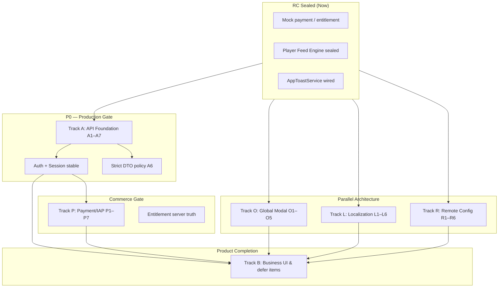

# Post-RC Roadmap & Phase Plan

日期：2026-05-17

本文是 **mock Release Candidate 封板之后** 的真实上线前路线图与任务拆分。当前前提：

- 所有 `USE_REMOTE_*` 默认 `false`
- 支付与权益走 mock（`grantMock*` / mock purchase delay）
- Player / Unlock / Recharge / Membership / Toast / Wallet / Store 主链路已通过 Android 真机 RC 回归
- QA P0/P1 无；RC P2 已收口
- **Release Readiness Review 2（2026-05-17）**：mock RC **可封板**；见 [release-seal-checklist.md](release-seal-checklist.md)

**本轮范围：** 只做方案与任务拆分，**不**改业务代码、不接真实 API/IAP、不迁移现有弹窗。

相关文档：

- [**Release Seal Checklist（封板 / QA / forbidden defines）**](release-seal-checklist.md)
- [Remote Contract Index](remote-contract-index.md)
- [Mock Data & API Readiness Review](mock-data-and-api-readiness-review.md)
- [Global Overlay / Modal System Plan](global-overlay-modal-system-plan.md)
- [App Runtime Foundation Plan](app-runtime-foundation-plan.md)
- [Entitlement Unlock Flow Plan](entitlement-unlock-flow-plan.md)

---

## 1. 总体阶段图



### 阶段总览

| 阶段 | 名称 | 目标 | 可并行 |
| --- | --- | --- | --- |
| **0** | RC 维护 | 仅 P0 热修；不扩 scope | — |
| **1** | API 基础设施 | Token、401、header、环境、strict DTO、session cleanup | O1、R1–R3、L1 |
| **2** | 只读内容联调 | Home/Drama/公共 Player 内容（无支付） | O2、L2–L3 |
| **3** | 登录态业务联调 | My List、Profile、Playback Source、Entitlement 读 | O3、L4 |
| **4** | 全局弹窗迁移 | Player/Auth/Store 弹窗上 AppModalHost | O4–O5 |
| **5** | 真实支付/IAP | 验单、订单状态机、替换 grantMock* | P1–P7 |
| **6** | 远程配置 & 实验 | Runtime 远程化、灰度/kill switch | R4–R6 |
| **7** | 业务 UI 收尾 | Settings、分页、字幕、活动等 defer | BIZ |

---

## 2. 推荐优先级（总表）

| 优先级 | 轨道 | 任务块 | 说明 |
| --- | --- | --- | --- |
| **P0** | A | A1–A3、A7 | 无则不可开 `USE_REMOTE_*` 生产默认 |
| **P0** | A | A6 | Commerce/Auth/Entitlement strict mapper |
| **P0** | P | P2、P5、P6 | 验单 + 订单状态机 + 全链路 entitlement refresh |
| **P1** | O | O1–O2 | 解决 For You/tab/Player 层级；迁移解锁/充值 |
| **P1** | A | A4–A5 | 真实 header + 环境策略 |
| **P1** | P | P1、P3–P4 | 商品契约 + 双端 IAP |
| **P2** | L | L1–L6 | 可与 A/O 并行，内容多语言依赖 API |
| **P2** | R | R1–R6 | 性能策略须保守默认 + kill switch |
| **P2** | BIZ | 第六节 defer 清单 | 依赖对应 API/支付就绪 |

### 推荐第一阶段从哪里开始

**主轨：Track A — `A1` + `A2` + `A3`（secure token + 401 refresh + ApiAuthPolicy）**

理由：

1. 所有 `ApiAuthPolicy.required` 接口在空 token 下当前仍有风险（见 [remote-contract-index.md](remote-contract-index.md)）。
2. 不开 401 队列则 remote 联调会出现「半登录态」脏缓存。
3. 与 Player/Commerce 无 UI 耦合，可小步提交、架构测试覆盖。

**并行轨（可多 agent）：**

- **Agent A：** `O1` AppModalService + AppModalHost skeleton（不改 Player 业务，只骨架 + fake service 测试）
- **Agent B：** `L1` 固定文案整理 + `R1` remote config repository 骨架
- **Agent C：** `P1` 商品 catalog contract 文档与 DTO 对齐（依赖后端评审，可无客户端代码）

**不建议第一阶段做：** 直接替换 `grantMock*`、默认打开 remote、PlayerFeedEngine 大拆、HLS local proxy 生产化。

---

## 3. Track O — Global Overlay / Modal System

> 详细设计见 [global-overlay-modal-system-plan.md](global-overlay-modal-system-plan.md)

### 3.1 目标

- 统一登录、解锁、充值、支付确认、会员购买、确认弹窗、活动弹窗、强更弹窗的 **展示层与层级**。
- 解决 For You / bottom tab / Player fullscreen 下弹窗被遮挡、safe area 不一致问题。
- 支持 typed request/result、modal queue、priority、dismiss policy、source context、fake service 测试。

### 3.2 必须用全局系统的弹窗

| 类型 | 当前实现 | 迁移原因 |
| --- | --- | --- |
| 登录 / session expired | Auth 规划 / 局部 route | 跨 tab、需挡操作 |
| 金币解锁确认 | `PlayerCoinUnlockSheet` | Player + For You 层级 |
| 充值大抽屉 | `PlayerRechargeUnlockSheet` | tab 遮挡、safe area |
| 支付确认 | recharge payment sheet | 与充值/Store 互斥 |
| Store 购买确认 | `StoreConfirmationSheet` | 需与支付结果串联 |
| Membership 购买确认 | membership confirmation | 同上 |
| Wallet Restore 等阻塞确认 | 已 toast；未来 blocking confirm | 支付相关须显式结果 |
| 强更 / 维护 | 未实现 | 最高优先级抢占 |
| 活动 / campaign 全屏弹窗 | 未实现 | 跨路由 |
| 风控 / 权限教育（跨路由） | 未实现 | 须 root host |

### 3.3 不必用全局系统的 UI

| 类型 | 保持局部的原因 |
| --- | --- |
| Player 内 Share / Speed / Synopsis sheet | 仅 Player 内、无跨 tab 需求 |
| Detail sheet（选集/简介） | Page 级 bottom sheet，不被 tab 挡 |
| Dropdown / 菜单 / tooltip | 无 typed result、无队列需求 |
| Pause feedback、loading overlay | 纯展示，非业务 modal |
| My List 左滑删除、编辑态 | 列表内交互 |
| 页面内非阻塞 SnackBar 类提示 | 已由 **AppToast** 承担 |

### 3.4 与 AppToastService 的关系

| 能力 | 入口 | 用途 |
| --- | --- | --- |
| 瞬态反馈 | `appToastProvider` → `AppToastService` | 成功/失败/信息，不阻塞流程 |
| 阻塞式选择 | `appModalServiceProvider` → `AppModalService` | 必须 await typed result |

实现上 **可共享** `AppRootOverlayHost` 的 Overlay 层，但 **feature 禁止**：

- 直接 `import bot_toast`
- 直接 `showModalBottomSheet` 处理 **跨 feature、跨 tab** 的支付/解锁/登录（迁移期可在 architecture test 中列为 warn → error）

### 3.5 子阶段拆分

#### O1 — AppModalService + AppModalHost skeleton — **Done**

| 项 | 内容 |
| --- | --- |
| **目标** | 根 host、typed API 空壳、`RecordingAppModalService`、队列接口占位 |
| **文件影响** | 新增 `lib/core/modal/*`；`lib/app/app.dart` + `app_root_navigator_key.dart`；`test/architecture/modal_boundary_test.dart` |
| **禁止项** | 不迁移 Player/Store；不改 unlock 逻辑；不接 API/IAP |
| **测试** | `app_modal_host_test`、`recording_app_modal_service_test`、`modal_boundary_test`、`app_modal_integration_test` |
| **依赖** | 无；可与 A1 并行 |
| **状态** | 已完成；Player 业务弹窗已在 O2 迁移，Store/Membership 仍在后续阶段 |

#### O2 — 迁移 Player unlock / recharge — **Done**

| 项 | 内容 |
| --- | --- |
| **目标** | Player coin unlock、recharge 通过 `AppModalService` 展示，避免 For You / bottom tab / Player Stack 层级遮挡 |
| **文件影响** | `player_unlock_modal_coordinator.dart`、`features/player/presentation/modal/*`、`player_page.dart`、`player_recharge_unlock_sheet.dart`、`core/modal/*` |
| **完成内容** | Player request/result 类型、Player modal presenter、root sheet、source dismiss、Player dispose 时 `dismissForSource(AppModalSource.player)` |
| **Payment Method 当前状态** | 作为 `PlayerRechargeUnlockSheet` 上方的局部 root `OverlayEntry`；已具备独立进出场动画，当前版本接受 |
| **保留项** | Player 详情、分享、倍速等局部 sheet 仍可用 `showModalBottomSheet` |
| **测试** | `player_page_test`、`test/core/modal/*`、`app_modal_integration_test`、`modal_boundary_test` |
| **依赖** | O1；A7 完成后可继续加强 session cleanup 时关闭 modal |

#### O2.1 — Player Payment Method AppModal 收口 — **Defer**

| 项 | 内容 |
| --- | --- |
| **目标** | 将 Player `Payment Method` 从播放器内 root `OverlayEntry` 迁入 AppModal / Payment channel |
| **动机** | 统一 modal queue、dismiss policy、session cleanup、typed result 和后续真实支付接入边界 |
| **建议 channel** | `player.payment_method` 或 `payment.method` |
| **建议 result** | `PaymentMethodModalResult.completed / cancelled / dismissed` |
| **要求** | 保留现有 UI、进出场动画、mock payment 业务结果；不接真实 IAP |
| **清理** | 删除 `PlayerRechargeUnlockSheet` 内部 `_paymentOverlay` / `_PaymentMethodOverlay` |
| **优先级** | P2 / post-RC cleanup；不阻塞当前 mock release |

#### O4 — 迁移 Store / Membership / Wallet confirmation — **Done**

| 项 | 内容 |
| --- | --- |
| **目标** | Store/Membership 购买确认走 `AppModalService`；Wallet 记录 no-op |
| **文件影响** | `store_page.dart`、`membership_page.dart`、`features/*/presentation/modal/*`、`features/*/application/*_modal_coordinator.dart`、`app_modal_registry_bootstrap.dart` |
| **完成内容** | `store.purchase_confirmation` / `membership.purchase_confirmation` channels；root sheet presenters；dispose dismiss by source |
| **Wallet** | 无阻塞确认弹窗；restore 仍 toast；auto unlock 页面 Switch |
| **禁止项** | 未接真实 IAP/API；未改 catalog；未改 mock purchase 结果 |
| **测试** | `store_page_test`、`membership_page_test`、`recording_app_modal_service_test`、`modal_boundary_test` |
| **依赖** | O1 |

#### O3 — 迁移 Auth login / session expired — Done

| 项 | 内容 |
| --- | --- |
| **目标** | 全局 Login modal；`AuthLoginModalResult`；`AuthModalCoordinator.showLogin` / `showLoginRequired` |
| **完成** | `auth.login` channel；Profile → modal；session cleanup dismiss auth modals；mock account link `guestId` |
| **策略** | refresh failed → cleanup → guest bootstrap；**不**启动自动弹登录；session expired 由 `showSessionExpiredLogin` 在用户操作时调用 |
| **禁止项** | 未接真实 OAuth / login API；modal 不写 token |
| **测试** | `auth_modal_coordinator_test`、`auth_login_modal_widget_test`、`app_modal_registry_test`、session cleanup dismiss |
| **Defer** | 401 拦截器自动弹窗；各业务 login gate 接入 |
| **依赖** | O1、A2（cleanup 路径已存在） |

#### O5 — AppModal control center finalization — Done

| 项 | 内容 |
| --- | --- |
| **目标** | 队列 priority + FIFO；dismiss policy；`AppModalObserver`；`AppModalRuntimeConfig` 本地预留 |
| **完成** | 不打断 current；`maxQueueLength=5`；`dismissForSource` 先清 pending；presenter 缺失不堵队列 |
| **不做** | 运营弹窗 / analytics SDK / remote config / 抢占 current |
| **测试** | `app_modal_queue_test`、`app_modal_controller_test`、`app_modal_policy_test`、`modal_boundary` 白名单 |
| **依赖** | O1–O4 |

### 3.6 README / 文档更新（Track O）

- `README.md` § Global Overlay：O1 完成后补 `appModalServiceProvider` 用法
- 更新 [global-overlay-modal-system-plan.md](global-overlay-modal-system-plan.md) 状态表
- [refactor-tracker.md](refactor-tracker.md) 新增 Track O 行

### 3.7 架构测试防绕过

| 规则 | 实现建议 |
| --- | --- |
| features 禁止 `import bot_toast` | 已有 `toast_boundary_test` |
| features 禁止直接 `import` modal host 实现 | 新增 `modal_boundary_test` |
| 跨 feature 阻塞弹窗须经 `AppModalService` | grep / custom_lint：`showModalBottomSheet` 在 `features/**/presentation/pages` 白名单外报错 |
| Player 禁止 `Navigator.of(context, rootNavigator: true)` 补丁式散落 | O2 完成后收紧 |

---

## 4. Track A — 真实 API 联调前准备

### 4.1 目标

从 mock skeleton 进入 staging/production API 前，补齐网络与会话基础设施；明确 **可先联调** 与 **必须登录后** 的接口边界。

### 4.2 子阶段拆分

#### A1.5 — Guest Session Bootstrap & Account Link（设计 + skeleton，2026-05-17）

| 项 | 内容 |
| --- | --- |
| **目标** | 把「游客也是 session」写入 API/session 设计；登录 = account link，不是简单换 token |
| **产品模型** | 首次启动 → device/install id → **guest bootstrap** → guest token；主动登录携带 guestId/deviceId → 服务端合并游客数据 → authenticated token；logout/refresh 失败 → cleanup → **重新 guest bootstrap**（推荐），非空 logged-out |
| **已完成** | 文档（本计划、`api-integration-plan`、`networking-guidelines`、`remote-contract-index`）；`AuthSessionKind`、`AuthTokenSessionKind` 字段注释；`GuestSessionBootstrap` cleanup 后 hook（stub，无网络） |
| **仍 defer** | 真实 `POST /auth/guest/session`（名称待定）；account link 登录 API；logout 后 guest 是否复用同一 guestId（服务端确认）；login 成功后 entitlement/wallet/profile/my list/progress 全量 refresh |
| **依赖** | A1（token storage）；**A4 提前**：Device-Id / install id 是 guest identity 基础 |
| **与 A7** | cleanup feature hooks 后调用 `GuestSessionBootstrap`；mock 阶段 entitlement 等回到 **guest-like default**，非保留正式用户态 |

**流程摘要：**

```text
首次启动: install/device id → guest bootstrap → guest token → Home/For You 以游客浏览
主动登录: login(guestId, deviceId, guestSession) → server link → authenticated token → refresh 各 feature
logout: cleanup hooks → guest bootstrap（推荐新 guest session，同 device）
refresh failed: clear auth token → cleanup → guest bootstrap → reload guest-safe 数据
```

#### A1 — secure token storage ✅（2026-05-17，客户端骨架）

| 项 | 内容 |
| --- | --- |
| **目标** | access/refresh token 加密存储；启动恢复 session |
| **已完成** | `AuthTokenSnapshot`、`AuthTokenStorage` 接口、`InMemoryAuthTokenStorage`（默认）、`FlutterSecureAuthTokenStorage`（可选实现，未默认启用）、`AuthTokenStore` 委托 storage 读写/清理 |
| **仍 defer** | 生产默认切到 secure storage；login 后真实持久化联调 |
| **禁止项** | 不把 token 放 SharedPreferences 明文；不在 UI 层读 storage |
| **测试** | `test/core/auth/auth_token_storage_test.dart`、`auth_token_store_test.dart`；架构边界 `auth_runtime_boundary_test.dart` |
| **依赖** | 无 |

#### A2 — 401 refresh queue / retry / logout cleanup ✅（2026-05-17，客户端骨架）

| 项 | 内容 |
| --- | --- |
| **目标** | 单飞 refresh；失败清 session；原请求重试一次 |
| **已完成** | `AuthRefreshCoordinator` 单飞；`ApiSessionAuthHandler` + `ApiClient` 统一 401 恢复（含 Dio 默认 `validateStatus` 抛出的 401）；refresh 成功重试一次；失败 `SessionCleanupCoordinator` 清 token + hook；refresh 请求 `apiSkipAuthRefreshExtraKey` 防递归 |
| **仍 defer** | `authRefreshExecutorProvider` 接真实 `POST /auth/refresh` |
| **禁止项** | 不在各 feature 自行 refresh |
| **测试** | `test/core/network/api_client_session_auth_test.dart` |
| **依赖** | **A1** |

#### A3 — ApiAuthPolicy.required 空 token 策略 ✅（2026-05-17）

| 项 | 内容 |
| --- | --- |
| **目标** | required 且无 token → 客户端 fail-fast，不发起 HTTP |
| **已完成** | 拦截器本地 `ApiException.sessionRequired`（`ApiErrorCode.sessionRequired`）；`none` 仍不带 token；refresh 用 `none` + `apiSkipAuthRefreshExtraKey` |
| **禁止项** | 禁止 silent 发空 Authorization |
| **测试** | `api_client_test.dart`、`api_client_session_auth_test.dart`、`api_request_context_provider_test.dart` |
| **依赖** | A1 |

#### A4 — Device-Id / App-Version / Lang / Platform 真实值 ✅（2026-05-17）

| 项 | 内容 |
| --- | --- |
| **目标** | 安装级 install id → `Device-Id`；`package_info_plus` → `App-Version`；locale → `Lang`（en/es/pt/hi，否则 en）；`Platform`（android/ios/web，桌面 debug 有 fallback） |
| **已完成** | `lib/core/runtime/install_id_*`、`app_version_provider`、`api_lang_provider`、`api_platform_provider`；`apiRequestContextProvider` 统一注入；`main` 绑定 `SharedPreferences` install id |
| **Device-Id** | **install id**（UUID 持久化），非硬件唯一 ID；logout 不清；清 App 数据可重生；**delete account 是否清 install id：待产品/合规** |
| **与 A1.5** | guest bootstrap 网络阶段通过 `ApiClient`（`none`）自动带 `Device-Id`（同 install id）及 Lang/Platform/App-Version |
| **禁止项** | 不在 feature 手写 header |
| **测试** | `install_id_provider_test`、`api_lang/platform/app_version_provider_test`、`api_request_context_provider_test` |
| **仍 defer** | delete account 清 install id；远程语言包替换 `apiLangProvider` 来源；真机 device model / RAM 完整 probe |
| **依赖** | 可与 A1 并行；**guest bootstrap 依赖稳定 Device-Id（A1.5 门禁）— 客户端侧已满足** |

#### A5 — remote switch 环境策略 dev/staging/prod

| 项 | 内容 |
| --- | --- |
| **目标** | baseUrl、开关矩阵；CI/debug 可切换；生产禁止误开全 remote |
| **文件影响** | `lib/core/config/*`、dart-define 文档、flavor |
| **禁止项** | 生产包默认 `USE_REMOTE_*=true` |
| **测试** | provider 默认 false；staging 集成配置测试 |
| **依赖** | A4 |

#### A8 — Remote integration guard & staging readiness — Done

| 项 | 内容 |
| --- | --- |
| **目标** | 统一 `RemoteApiSwitches` + `RemoteApiReadinessGuard`；staging smoke 文档；默认仍 mock |
| **完成** | 风险分级；prod/staging/dev guard；`effective` fail-closed；legacy `USE_REMOTE_API` → drama |
| **文档** | [remote-api-staging-checklist.md](remote-api-staging-checklist.md)、[release-seal-checklist.md](release-seal-checklist.md) |
| **不做** | 不接真实 API；不改 provider 默认选型为 effective（A8.1 defer） |
| **测试** | `remote_api_readiness_guard_test.dart`、`remote_api_guard_boundary_test.dart` |
| **依赖** | A4、A6、A7 |

#### A6 — strict DTO / required field policy ✅（2026-05-17）

| 项 | 内容 |
| --- | --- |
| **目标** | strict 字段 fail-fast；display 字段可 fallback |
| **已完成** | `JsonFieldParser` + `ApiMappingException`；Auth/Player/Drama/Entitlement/Commerce/MyList remote DTO strict；remote decoder 非 map fail-fast；mapper unknown enum 不再默认危险值 |
| **禁止项** | 不用空 title 冒充成功订单/权益 |
| **测试** | `json_field_parser_test`、`auth/player/drama/entitlement/commerce/my_list_dto_strict_test`、`dto_strict_policy_test` |
| **仍 defer** | Profile DTO、FavoriteMutation、Wallet 子记录、Subtitle/Sprite 全量 |
| **依赖** | 后端 schema 冻结（见 §4.4） |

#### Home/Drama Remote Integration Dry Run ✅（2026-05-17）

| 项 | 内容 |
| --- | --- |
| **目标** | fake HTTP dry run 验证 Home/Drama 只读 remote 链路（不接真实 server） |
| **Harness** | `test/helpers/recording_http_adapter.dart`、`fake_api_envelope.dart`、`drama_remote_dry_run_harness.dart` |
| **测试** | `test/features/drama/drama_remote_dry_run_test.dart` |
| **Endpoints** | `GET /home/categories`、`GET /home/feed`（`ApiAuthPolicy.none`） |
| **验证** | headers、envelope、`ApiMappingException` strict、`USE_REMOTE_DRAMA_API` provider 切换；**默认仍 mock** |
| **Staging** | `flutter run --dart-define=API_BASE_URL=https://<staging-host> --dart-define=USE_REMOTE_DRAMA_API=true`（无默认 staging URL） |
| **不包含** | Player playback source、Entitlement、Wallet/Store/Membership、真实 IAP |
| **错误策略** | remote 失败抛 `ApiException` / wrapped `ApiMappingException`；**不静默 fallback mock** |

#### A7 — session cleanup（feature cache + player session）— Done

| 项 | 内容 |
| --- | --- |
| **目标** | refresh failed / logout / deleteAccount / sessionExpired 后 guest-safe 一致态 |
| **已完成** | 清 token → `dismissAllBlockingBusinessModals`（player/store/membership/auth + 清空 queue）→ `AuthController.resetForSessionCleanup` → Entitlement/Wallet/Profile/MyList/Store/Membership reset → Player pause/dispose/preload/startup cancel → `GuestSessionBootstrap` stub |
| **Reason** | `refreshFailed` / `sessionExpired` / `unauthorized`：ApiSessionAuthHandler；`logout` / `deleteAccount`：SessionCleanupAuthRepository |
| **autoUnlock** | Entitlement cleanup **保留** `autoUnlockEnabled` 本地偏好 |
| **no-op** | Home/Drama mock feed（无用户态缓存）；Toast 自然消失 |
| **仍 defer** | 真实 guest bootstrap API；cleanup 后各 feature guest 数据 refetch |
| **禁止项** | core 不 import features；UI 不直接调 coordinator（logout/delete 经 repository） |
| **测试** | `session_cleanup_coordinator_test`、`feature_session_cleanup_test`、`auth_session_cleanup_test`、`app_modal_business_cleanup_test`、`player_session_cleanup_test`、`session_cleanup_boundary_test` |
| **依赖** | **A2**、O5 modal dismiss |

### 4.3 接口联调顺序

| 顺序 | 模块 | 开关 | Auth | 前置条件 |
| --- | --- | --- | --- | --- |
| 1 | Home / Drama | `USE_REMOTE_DRAMA_API` | mostly `none` | A4、A6（drama mapper） |
| 2 | Player 内容 / For You feed | `USE_REMOTE_PLAYER_API` | `none`（当前） | Drama 稳定；A6 |
| 3 | Auth / Session | `USE_REMOTE_AUTH_API` | — | **A1–A3** |
| 4 | Profile | `USE_REMOTE_PROFILE_API` | required | Auth 稳定 |
| 5 | Playback Source | `USE_REMOTE_PLAYER_API` | required | Auth + entitlement 读 |
| 6 | My List | `USE_REMOTE_MY_LIST_API` | required | Auth |
| 7 | Entitlement 读/写 | `USE_REMOTE_ENTITLEMENT_API` | required | Auth；unlock 幂等 schema |
| 8 | Wallet | `USE_REMOTE_WALLET_API` | required | Entitlement 聚合策略 |
| 9 | Store / Membership 订单创建 | remote store/membership | 商品 none、订单 required | **A1–A3**；订单 API |
| 10 | 全量 commerce | + IAP track P | required | **P2–P5** |

### 4.4 上线前 P0 风险清单（API）

| # | 风险 | 缓解 |
| --- | --- | --- |
| 1 | 空 token 调 required 接口 | A3 |
| 2 | 401 并发刷新风暴 | A2 单飞队列 |
| 3 | refresh 失败后旧 entitlement 仍显示 | A7 + A1.5 guest bootstrap |
| 3b | 生产无 guest bootstrap，首次启动/ logout 后无有效 session | **A1.5（P0）** |
| 3c | logout 后仍展示正式用户会员/余额 | A7 cleanup + A1.5 |
| 4 | strict 字段 fallback 导致假成功 | A6 |
| 5 | staging/prod baseUrl 混用 | A5 + CI guard |
| 6 | `grantMock*` 误留在 remote repository | code review + architecture test |
| 7 | Player 播放源过期未 refresh | playback source 文档 + 联调清单 |

### 4.5 测试计划（Track A）

- 单元：`api_client_test`、`api_client_session_auth_test`、token storage / token store、mapper strict
- 集成：staging `USE_REMOTE_DRAMA_API=true` 手工 + 可选 integration_test（A1–A3 后仍 defer）
- 架构：`architecture/auth_runtime_boundary_test.dart`（token storage / refresh / cleanup 不进 presentation）
- 回归：mock 默认路径仍全绿（`USE_REMOTE_*` 默认 false）

### 4.6 A1–A3 行为摘要（联调门禁）

| 场景 | 行为 |
| --- | --- |
| `ApiAuthPolicy.required` + 无 access token | **不发 HTTP**；抛 `ApiErrorCode.sessionRequired`（客户端本地拦截，非伪造后端 401） |
| `ApiAuthPolicy.none` | 不带 `Authorization`，可无 token 正常请求 |
| `POST /auth/refresh` | `none` + `apiSkipAuthRefreshExtraKey`；refresh 自身 401 不进入 refresh 队列 |
| 业务接口 HTTP 401 + `required` | `ApiSessionAuthHandler` 单飞 refresh → 成功则 **原请求重试 1 次** |
| refresh 失败 / 无 refresh token | `SessionCleanupCoordinator.cleanup` 清 token + feature hooks（A7）；请求以 `unauthorized` / Session expired 结束 |

---

## 5. Track P — 真实支付 / IAP / Entitlement

### 5.1 目标

替换 mock payment / `grantMock*`；**支付成功必须服务端验单后刷新 entitlement**；客户端不得生产路径本地累加余额/会员。

### 5.2 mock grantMock* 隔离策略

| 环境 | 行为 |
| --- | --- |
| **生产 / staging 正式包** | `RemoteEntitlementRepository.grantMock*` → `UnsupportedError` 或 no-op + log；仅 `refreshFromServer()` |
| **单元 / widget test** | `MockEntitlementRepository` + `RecordingAppToastService` |
| **开发 debug 菜单** | 可选 `DebugEntitlementRepository` 包装 mock，须 `kDebugMode` + dart-define |
| **架构测试** | `grantMockCoins` / `grantMockMembership` 调用点白名单：仅 mock repo + test |

### 5.3 真实阶段 UI 等待策略

| 步骤 | UI 行为 |
| --- | --- |
| 用户点购买 | modal/sheet → `processing` |
| 平台 IAP 返回 | 上传 purchase token → `POST /orders/{id}/verify` |
| 验单成功 | **await** `GET /entitlements`（+ wallet/profile 若需要） |
| 刷新完成 | 关闭 modal、toast、继续 unlock flow |
| 验单失败 / 超时 | 明确失败态；可重试；**不**本地加币 |

### 5.4 退款 / 撤销 / 过期

| 事件 | 客户端 |
| --- | --- |
| 订单 `refunded` / `revoked` | 服务端 entitlement 收回；客户端 refresh 后更新 UI |
| 订阅过期 | `GET /membership/status` + entitlement；Player 按 decision 走 membership 解锁 |
| 跨设备 | 以服务端 entitlement 为准；本地不持久化「已会员」真相 |
| 离线 | 展示缓存 + 过期提示；恢复网络后强制 refresh |

### 5.5 子阶段拆分

#### P1 — 统一商品 catalog contract

| 项 | 内容 |
| --- | --- |
| **目标** | Store / Membership / Player recharge 共用 `ProductCatalog` domain |
| **文件影响** | 新 `lib/features/commerce/domain/*`；对齐 remote DTO |
| **禁止项** | 不合并 UI 布局 |
| **测试** | catalog mapper 单测 |
| **依赖** | **后端商品 API 稳定** |

#### P2 — OrderRepository / IapRepository / Entitlement refresh

| 项 | 内容 |
| --- | --- |
| **目标** | 创建订单 → 平台支付 → 验单 → refresh entitlement |
| **文件影响** | `order_repository`、`iap_repository`、`entitlement_controller` |
| **禁止项** | PlayerFeedEngine 不直接调 IAP SDK |
| **测试** | fake IAP + fake order server |
| **依赖** | A1–A3、P1、**服务端验单 API** |

#### P3 — Google Play purchase flow

#### P4 — Apple IAP purchase flow

（P3/P4 结构同 P2，分平台 SDK；可并行两人）

| 禁止项 | 不接平台前不删 mock purchase UI |
| 依赖 | P2、平台开发者账号与商品配置 |

#### P5 — 订单状态机

状态：`created` → `pending` → `paid` | `failed` | `refunded` | `revoked`

| 项 | 内容 |
| --- | --- |
| **文件影响** | order domain、mapper、UI 状态映射 |
| **测试** | 状态迁移表驱动测试 |

#### P6 — Wallet / Store / Membership / Player recharge 全链路

| 项 | 内容 |
| --- | --- |
| **目标** | 删除生产路径 `confirmMockPurchase`；统一走 Order + refresh |
| **文件影响** | `store_controller`、`membership_controller`、`player_recharge_unlock_controller`、`wallet_controller` |
| **依赖** | P2–P5、**O2/O4**（支付 modal 结果） |

#### P7 — Profile 会员/金币聚合展示

| 项 | 内容 |
| --- | --- |
| **目标** | Profile 只读聚合 entitlement + membership status |
| **依赖** | P6、Profile remote |

### 5.6 测试计划（Track P）

- 单测：订单状态机、catalog mapper
- 集成：sandbox 验单（Android/iOS 分轨）
- 回归：mock 开关关闭后跑 commerce + player unlock 全链路
- 架构：禁止 feature import `in_app_purchase`（仅 iap_repository 实现层）

---

## 6. Track L — 多语言系统

### 6.1 固定 UI vs 内容文案边界

| 类型 | 来源 | 示例 |
| --- | --- | --- |
| **固定 UI** | `AppLocalizations` + 可选远程覆盖 | 导航、按钮、错误态、Wallet 标签 |
| **内容** | 业务 API 按 `Lang` 返回 | 剧名、简介、分类名、商店营销文案（若服务端下发） |
| **播放器字幕** | playback source `subtitleTracks` | 按 locale 匹配 track，非 AppLocalizations |

### 6.2 失败 fallback

| 场景 | 策略 |
| --- | --- |
| 远程固定文案包下载失败 | 使用本地 `AppLocalizations` |
| 远程 key 缺失 | en 兜底 → key（仅 debug 可见） |
| 内容 API 无该语言 | 服务端 fallback 或客户端显示 en/默认 |
| 字幕无匹配 track | `RuntimeLocalizationConfig.subtitleFallbackLocale`；否则关闭字幕 |

### 6.3 与 ApiRequestContext.Lang 的关系

- 用户选择语言 → 更新 `Locale` + persistence
- `apiRequestContextProvider` 的 `Lang` 与 UI locale **同步**
- 内容请求、远程文案包、`Accept-Language` 均使用同一来源
- **禁止** feature 自行拼接 `Lang` header

### 6.4 子阶段拆分

| 阶段 | 目标 | 主要文件 | 禁止项 |
| --- | --- | --- | --- |
| **L1** | 固定文案 key 整理、去重、补 test | `lib/l10n/app_localizations.dart` | 不强制 ARB 迁移 |
| **L2** | 远程语言包 version/check/download/cache | `core/localization/*`、`RuntimeLocalizationConfig` | 不阻塞启动 |
| **L3** | RuntimeLocalizationConfig 接入 App 启动 | `app.dart`、`app_runtime_config_provider` | 失败不 crash |
| **L4** | 内容 API 按 Lang 拉取 | drama/player remote datasource | 不改 Player 引擎 |
| **L5** | 字幕 tracks 选择 | `playback_source_mapper`、Player UI | 不做 sprite |
| **L6** | 语言切换刷新 Home/Drama/Player | 各 controller `reload` | 不清 playback 进度除非产品要求 |

### 6.5 测试计划（Track L）

- 单测：locale → Lang、字幕选择算法
- Widget：Language 页切换后文案变化
- 集成：缓存命中/过期、断网 fallback

### 6.6 依赖

- L2–L3 可与 A、O 并行
- L4–L6 依赖 **A4**、内容 API **Lang 参数稳定**

---

## 7. Track R — Global Runtime / Remote Config

### 7.1 允许远程控制的配置

| 配置 | 示例 | 备注 |
| --- | --- | --- |
| Feature flags | 活动入口、experimental UI | 可关 |
| Player preload 数量/距离 | 预加载条数 | **须有上限钳制** |
| Performance mode 建议 | 仅允许 **更保守** 方向 | 见 §7.2 |
| 文案包版本 | 与 L2 共用 | — |
| Kill switch | 关闭充值入口、关闭 For You | 合规/事故用 |

### 7.2 禁止远程打开的危险配置

| 配置 | 原因 |
| --- | --- |
| HLS local proxy / segment cache 生产化 | [player-local-hls-proxy-cache.md](player-local-hls-proxy-cache.md) |
| 远程将 `ultraStable` 降为 `rich` | 低端机 OOM/卡顿 |
| 远程增大 preload 超过本地 clamp | 内存风险 |
| 远程跳过验单 | 资金风险 |
| 远程关闭 strict DTO | 数据错乱 |

### 7.3 低端设备保守策略

- 本地 `DeviceCapability` + denylist **始终生效**
- 远程 merge 规则：`remoteMode = min(localMode, remoteSuggestion)`（只能更保守）
- `RuntimePlayerConfig` 中 preload、timing log 等有 hard cap

### 7.4 子阶段拆分

| 阶段 | 目标 | 文件影响 | 禁止项 |
| --- | --- | --- | --- |
| **R1** | Remote config repository / DTO / mapper | `core/runtime/remote_config/*` | 不接 UI |
| **R2** | 启动拉取 + 本地缓存 | `app_runtime_config_provider` | 失败阻塞启动 |
| **R3** | 失败 fallback 到 Phase A 默认 | 已有 defaults | — |
| **R4** | 版本 / TTL / 签名校验 | config DTO | 无签名不接生产 |
| **R5** | Player preload / performance policy 接入 | `runtime_player_config`、`player_preload_config_provider` | 不改 FeedEngine 主逻辑 |
| **R6** | 灰度 / A/B / kill switch | `RuntimeFeatureFlagConfig` | 不远程放开危险项 |

### 7.5 测试计划（Track R）

- 单测：merge 钳制、fallback
- 架构：`runtime_boundary_test` 扩展
- 手工：弱网启动、过期缓存

### 7.6 依赖

- R1–R3 可与 A1、O1 并行
- R4–R6 依赖 **服务端 config API** 与签名方案

---

## 8. Track B — 业务页面与 UI 后续（现有 defer）

| 项 | 当前状态 | 建议阶段 | 依赖 |
| --- | --- | --- | --- |
| **Settings 正式页** | Profile placeholder | BIZ-1 | 产品清单；可无 API |
| **Profile 会员/金币聚合** | 部分 entitlement | BIZ-2 | P7、Profile remote |
| **My List 网络图 + 分页** | mock 本地图 | BIZ-3 | `USE_REMOTE_MY_LIST_API`、图片 CDN |
| **Store / Membership 商品真实 UI 状态** | mock 价签 | BIZ-4 | P1、P6 |
| **Wallet 账单/奖励/分页** | mock 列表 | BIZ-5 | Wallet remote、P6 |
| **Player subtitle** | DTO skeleton | BIZ-6 | L5、playback source |
| **Player preview sprite / seek thumb** | defer | BIZ-7 | playback source API |
| **Activity / campaign** | 未实现 | BIZ-8 | O5、运营 API |
| **Profile Settings 入口** | placeholder 已有 | BIZ-1 | — |
| **三商品 catalog 统一展示** | 三套 mock | BIZ-4 | P1 |
| **bonus 扣费规则** | 当前不扣 bonus | 产品确认后 | entitlement API |
| **ARB/gen-l10n 迁移** | 手写 l10n | L1+ | 可选 |

### BIZ 阶段通用禁止项

- 不改 PlayerFeedEngine / PlaybackController 主链路（除非对应 track 显式授权）
- 不 default 打开 remote
- 不接真实 IAP（除非在 P 轨道）

### BIZ 测试计划

- 每页 widget + controller 测试
- 真机 RC 回归清单扩展 [entitlement-commerce-player-regression.md](entitlement-commerce-player-regression.md)

---

## 9. 阶段间依赖关系（汇总）

```text
A1 ──► A2 ──► A3 ──► A7
 │      │
 │      └──► O3 (session expired)
 │
 ├──► A4 ──► A5
 │
 └──► A6 ──► 所有 remote mapper

A1–A3 + A7 ──► Auth/MyList/Profile/Entitlement remote
A6 + Drama API ──► Home/Drama/Player 只读 remote
A1–A3 + P2 ──► Commerce remote + IAP
P1 (backend) ──► P2–P6
O1 ──► O2–O4 ──► O5
R1–R3 ──► R4–R6 (server)
L1 ──► L2–L3 ──► L4–L6 (content API)
P6 + O4 + A7 ──► BIZ-4/5/7
```

---

## 10. 并行化建议（多 Agent）

| Agent 轨道 | 任务 | 阻塞关系 |
| --- | --- | --- |
| **Agent 1 — Network** | A1→A2→A3→A7 | 阻塞所有 required API |
| **Agent 2 — Modal** | O1→O2 | O3 需等 A2 |
| **Agent 3 — Runtime** | R1→R2→R3 | R4+ 需服务端 |
| **Agent 4 — L10n** | L1→L2→L3 | L4+ 需内容 API |
| **Agent 5 — Commerce spec** | P1 文档/契约评审 | 阻塞 P2 |
| **Agent 6 — Drama QA** | A4+A6+Home remote 联调 | 需 staging |
| **Agent 7 — BIZ UI** | Settings、My List UI | 部分无 API 可做 |

**强串行（不可并行）：**

- P6（真实支付接入）在 P2 之后
- O3（Auth modal）在 A2 之后
- 生产开 `USE_REMOTE_ENTITLEMENT_API` 在 A7 + P2 之后

---

## 11. 必须等服务端接口稳定的任务

| 客户端任务 | 依赖服务端 |
| --- | --- |
| P1 商品 catalog | 商品列表、平台 sku id、地区价 |
| P2 验单 | `POST /orders/{id}/verify`、幂等 |
| P5 订单状态机 | 订单查询、webhook 驱动状态 |
| Entitlement unlock | `POST /entitlements/unlock-episode` 幂等 operationId |
| Playback source | signed URL、expiresAt、refresh |
| R4 远程配置签名校验 | config manifest + public key |
| L4 内容多语言 | `Lang` 参数与字段约定 |
| Activity/campaign | 投放 API |

**可先客户端落地（stub/server 未就绪）：**

- O1、A1–A4、A7 设计实现（mock server）
- L1、L3
- R1–R3 本地默认
- P1 domain 模型（字段待对齐）

---

## 12. 上线前 P0 检查清单（汇总）

### 架构 / 网络

- [x] A1 secure token（storage 抽象 + in-memory 默认；secure 实现已备未默认）
- [x] A2 401 refresh 单飞 + retry 一次 + cleanup 骨架
- [x] A3 required 空 token fail-fast（`sessionRequired`）
- [ ] A6 strict DTO（auth、entitlement、order、playback source）
- [x] A7 session cleanup（feature hooks + player pause/dispose；modal/toast defer）
- [ ] A1.5 guest bootstrap 真实 API + account link 登录（设计/skeleton 已完成）
- [ ] 生产环境 guest bootstrap 策略（P0）
- [ ] 生产 remote repository 无 `grantMock*`

### 商业 / 权益

- [ ] P2 验单后才 refresh entitlement
- [ ] P5 订单状态机与退款/撤销
- [ ] P6 全入口接入（Store/Membership/Player recharge）
- [ ] Wallet/Profile 展示与服务端一致
- [ ] auto-unlock 设置走服务端 PATCH

### 体验 / 合规

- [ ] O2 解锁/充值/支付 modal 不被 tab 遮挡（或 O1+最小修复已验证）
- [ ] 强更/kill switch 路径（R6 + O5）
- [ ] 远程配置不能放宽低端机策略（R5 钳制）

### 验证命令（每阶段合并前）

```bash
dart format lib test integration_test
flutter analyze
flutter test
```

---

## 13. README / 文档更新计划

| 时机 | 更新 |
| --- | --- |
| A5 完成 | README：环境开关、staging 联调说明 |
| O1 完成 | README：`AppModalService`；链接 global-overlay 计划状态 |
| P6 完成 | README：移除 mock payment 说明；改 entitlement refresh |
| R2 完成 | [app-runtime-system.md](app-runtime-system.md) 远程配置章节 |
| L3 完成 | [localization-and-home-data-architecture.md](localization-and-home-data-architecture.md) |
| 每 track 结束 | [refactor-tracker.md](refactor-tracker.md) 状态行 |
| 全量上线前 | [remote-contract-index.md](remote-contract-index.md) 默认开关表改 production |

---

## 14. 与当前封板代码的对应关系

| 封板能力 | 下阶段演进 |
| --- | --- |
| `EntitlementController` + `evaluateAccess` | 保留；remote 只换 repository |
| `PlayerFeedEngine` sheet intent | O2 改为 modal intent |
| `AppToastService` | 保留；与 modal 并列 |
| `MockEntitlementRepository.grantMock*` | 限制到 test/debug |
| `USE_REMOTE_*` skeleton | A5 + A6 后逐模块打开 |
| `PlayerPerformancePolicy` | R5 远程建议，本地钳制 |
| `@Deprecated` PlayerUnlockSheet | O2 完成后删除 |

---

## 15. 文档维护

- Owner：客户端架构负责人
- 更新频率：每完成一个子阶段（O1、A2、P2…）更新本节状态表
- 下次评审：后端 API 契约评审后更新 §4.3、§5 P1、§11

**状态表（初始）**

| 子阶段 | 状态 |
| --- | --- |
| O1 | Done |
| O2–O5 | Planned |
| A1–A3 | **Done**（客户端 session/network 骨架；见 §4.6） |
| A1.5 | **Design + skeleton**（guest bootstrap / account link；见 §4.2 A1.5） |
| A4 | **Done**（真实 Device-Id / App-Version / Lang / Platform；见 §4.2 A4） |
| A5 | Planned |
| A6 | **Done**（strict DTO；见 §4.2 A6） |
| A7 | **Done**（见 §4.2 A7） |
| P1–P7 | Planned |
| L1–L6 | Planned |
| R1–R6 | Planned |
| BIZ-1–BIZ-8 | Planned |
